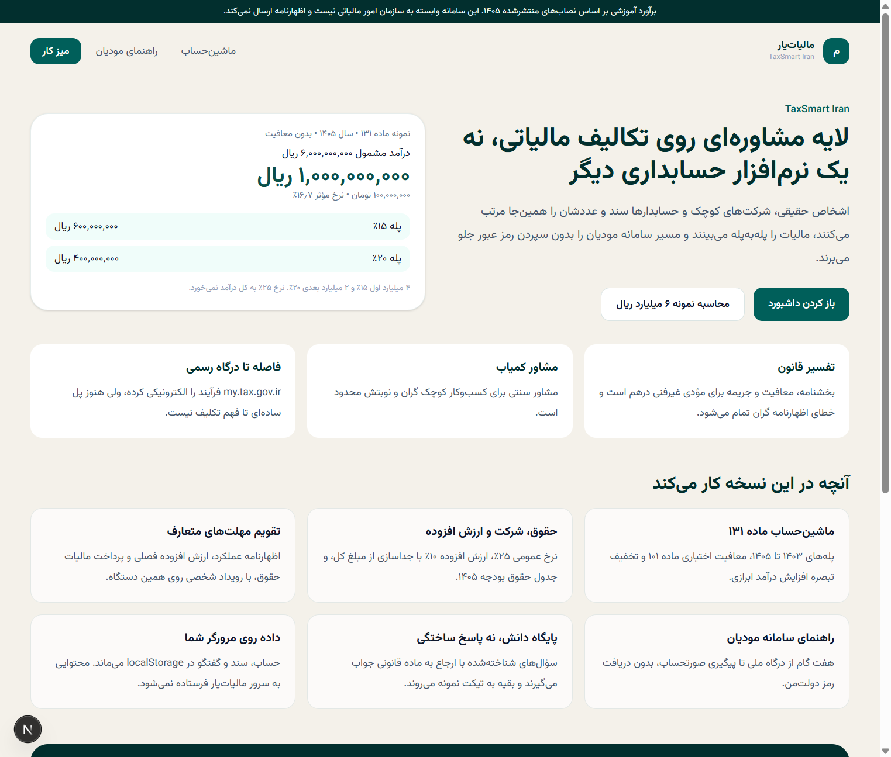
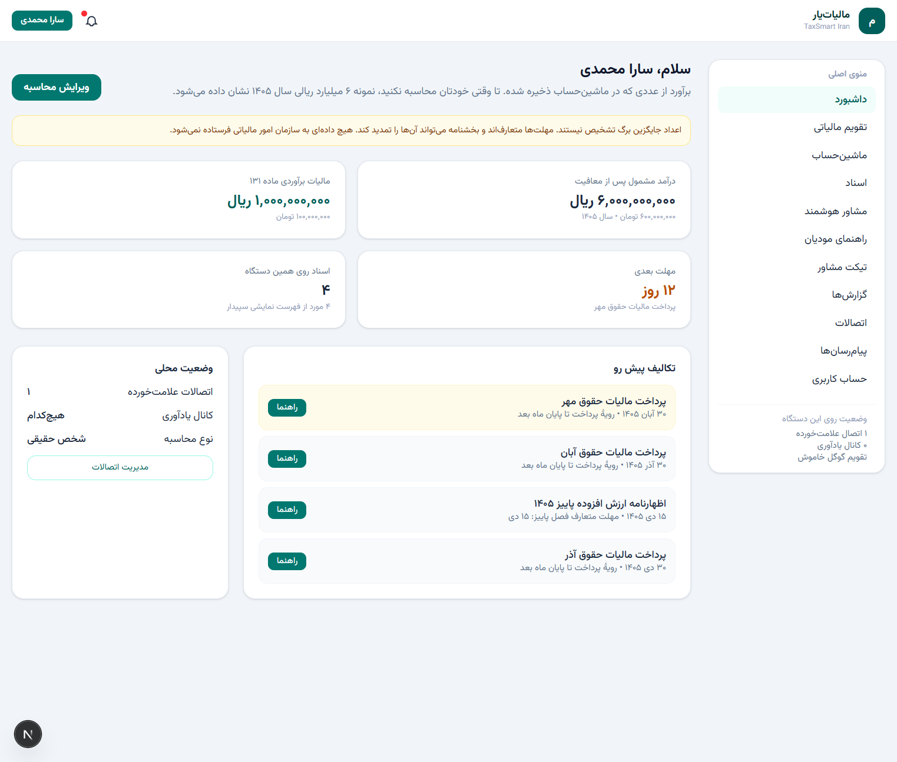

<p align="center">
  
</p>

<h1 align="center">مالیات‌یار</h1>
<p align="center">
  <strong>TaxSmart Iran</strong><br>
  لایهٔ مشاوره‌ای برای برآورد مالیات، یادآوری مهلت‌ها و راهنمای سامانه مودیان
</p>

<p align="center">
  
  
  
  
</p>

<p align="center">
  <a href="#شروع-سریع">شروع سریع</a> ·
  <a href="#چه-کاری-می‌کند">قابلیت‌ها</a> ·
  <a href="#محاسبه‌ها">محاسبه‌ها</a> ·
  <a href="#این-نسخه-چه-چیزی-نیست">محدوده</a>
</p>

---

English: a Persian, right-to-left workspace for Iranian tax estimates, deadline reminders, and a guided path through the taxpayer portal. It does not file returns, does not store documents on a server, and is not part of the Iranian National Tax Administration.

> برآوردها آموزشی‌اند و بر اساس نصاب‌های منتشرشدهٔ سال‌های ۱۴۰۳ تا ۱۴۰۵ نوشته شده‌اند. مالیات‌یار برگ تشخیص، اظهارنامه یا نظر سازمان امور مالیاتی نیست. بخشنامه می‌تواند مهلت‌ها را عوض کند.

## شروع سریع

```bash
npm install
npm run dev
```

سپس [http://localhost:3000](http://localhost:3000) را باز کنید.

| دستور | کار |
| --- | --- |
| `npm run dev` | میز کار را روی پورت ۳۰۰۰ بالا می‌آورد |
| `npm run lint` | بررسی ESLint |
| `npm run build` | ساخت نسخهٔ تولید |
| `npx tsx scripts/check.ts` | آزمون تاریخ جلالی، ماده ۱۳۱، حقوق، ارزش افزوده و رقم کنترل کد ملی |

## چه کاری می‌کند

<p align="center">
  
</p>

| بخش | مسیر | کار |
| --- | --- | --- |
| معرفی | `/` | مسئله، قابلیت‌ها و نمونهٔ محاسبه |
| داشبورد | `/dashboard` | برآورد ذخیره‌شده، مهلت بعدی و وضعیت محلی |
| تقویم | `/calendar` | مهلت‌های متعارف و رویداد شخصی روی همین دستگاه |
| ماشین‌حساب | `/calculator` | حقیقی، حقوقی، ارزش افزوده، حقوق و جریمه |
| اسناد | `/documents` | فهرست نام و حجم فایل؛ محتوای سند خوانده نمی‌شود |
| مشاور | `/advisor` | پاسخ از پایگاه دانش قوانین، با رد درخواست پنهان‌کاری |
| راهنمای مودیان | `/guide` | هفت گام تا صورتحساب الکترونیکی، بدون دریافت رمز |
| تیکت | `/tickets` | ثبت سؤال و پاسخ نمونه؛ مشاور انسانی وصل نیست |
| گزارش | `/reports` | پیش‌نمایش چاپ از همین صفحه |
| اتصالات | `/integrations` | علامت محلی نرم‌افزارها؛ کلید و ورود واقعی ندارد |
| پیام‌رسان | `/messaging` | ترجیح یادآوری؛ پیامی ارسال نمی‌شود |
| حساب | `/account` | پروفایل حقیقی یا حقوقی، فقط در همین مرورگر |

حساب، گفتگو، تیکت، علامت راهنما و فرادادهٔ اسناد در `localStorage` با کلید `maliyat-yar-v1` می‌مانند. بستن حساب یا پاک کردن داده‌ها همان ذخیرهٔ محلی را خالی می‌کند.

## محاسبه‌ها

نرخ بالاتر فقط به مازاد همان پله می‌خورد.

**ماده ۱۳۱، عملکرد ۱۴۰۵.** تا ۴ میلیارد ریال ۱۵٪، مازاد تا ۸ میلیارد ۲۰٪، و مازاد بر آن ۲۵٪. نمونهٔ بدون معافیت برای درآمد ۶ میلیارد ریال: ۱ میلیارد ریال مالیات. معافیت ماده ۱۰۱ اختیاری است و پیش‌فرض صفر است. تخفیف تبصرهٔ افزایش درآمد ابرازی فقط وقتی اعمال می‌شود که کاربر تسویهٔ سال قبل و تسلیم به‌موقع اظهارنامه را تأیید کند.

**اشخاص حقوقی.** نرخ عمومی ماده ۱۰۵ برابر ۲۵٪ است. نرخ خاص را خود کاربر، حداکثر تا ۲۵٪، وارد می‌کند.

**ارزش افزوده ۱۴۰۵.** نرخ عمومی ۱۰٪ است: ۹٪ ماده ۷ به‌علاوه یک واحد بودجه. می‌توان مالیات را به مبلغ خالص افزود یا از مبلغ کل جدا کرد. سوخت، دخانیات و اجرت طلا نرخ دیگری دارند و خودکار اعمال نمی‌شوند.

**حقوق ۱۴۰۵.** معافیت ماهانه تا ۴۰۰ میلیون ریال، سپس پله‌های ۱۰، ۱۵، ۲۰، ۲۵ و ۳۰ درصد. نمونهٔ ۹۰۰ میلیون ریال: ۵۵ میلیون ریال مالیات. بیمه و نرخ هیئت علمی اعمال نمی‌شود؛ مبلغ باید از قبل مشمول باشد.

**جریمهٔ آموزشی.** دیرکرد عملکرد ۲٫۵ درصد در ماه، دیرکرد ارزش افزوده ۲ درصد در ماه، و عدم تسلیم ۰، ۱۰ یا ۳۰ درصد. بخشودگی خودکار نیست.

## این نسخه چه چیزی نیست

- به [my.tax.gov.ir](https://my.tax.gov.ir)، دولت‌من، سامانه مودیان، سپیدار، راهکاران یا حسابفا وصل نمی‌شود.
- اظهارنامه نمی‌فرستد و صورتحساب الکترونیکی صادر نمی‌کند.
- رمز عبور، کد یکبارمصرف و محتوای فایل را نمی‌گیرد.
- مدل زبانی زنده نیست؛ مشاور بر اساس کلیدواژه و ارجاع قانونی جواب می‌دهد.
- پیامک، تلگرام، بله و واتساپ را فقط به‌صورت ترجیح محلی نگه می‌دارد.
- قیمت‌های صفحهٔ معرفی پیشنهادی‌اند و درگاه پرداخت ندارند.

## ساختار

```text
app/                 صفحات معرفی و میز کار
components/          پوسته، فرم‌ها و نماها
lib/tax.ts           پلکان‌ها و نرخ‌ها
lib/jalali.ts        تبدیل و قالب تاریخ شمسی
lib/knowledge.ts     پاسخ‌های قانونی و رد فرار مالیاتی
lib/deadlines.ts     مهلت‌های متعارف
lib/store.tsx        ذخیرهٔ محلی مرورگر
scripts/check.ts     کنترل اعداد نمونه
```

دادهٔ محلی بعد از اولین نقاشی صفحه خوانده می‌شود تا متن سرور و مرورگر در هیدراته شدن یکی بماند.
